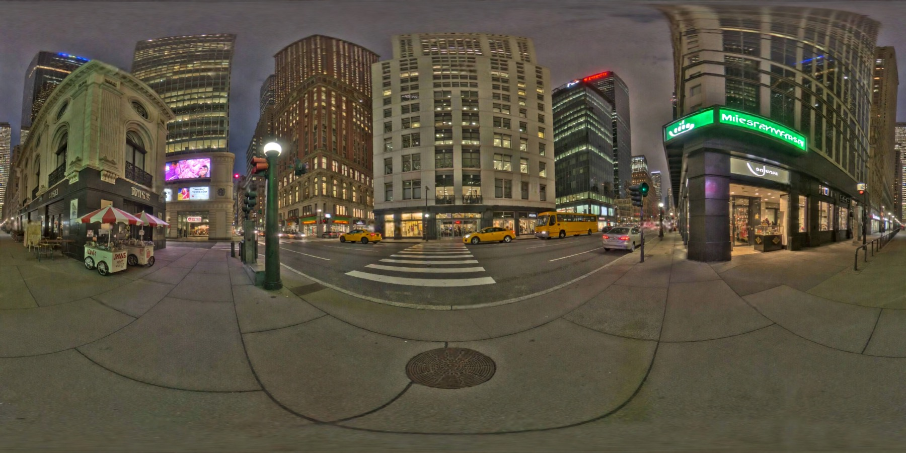

# Midtown NYC — a World Labs Marble world

A walkable 3D Gaussian-splat world of a Midtown Manhattan intersection, generated
with the [World Labs](https://www.worldlabs.ai) Marble API (`marble-1.1-plus`) and
rendered in the browser with [Spark](https://sparkjs.dev) + three.js.



## View it

```bash
npm install
npm start
# then open http://localhost:8123
```

`npm start` runs `server.mjs`, which serves the site and powers the chatbox. The chat uses the
Claude Agent SDK with **this machine's own Claude Code login** (no API key is stored anywhere), so
`claude` must be installed and logged in. Without the server (e.g. `python3 -m http.server`), the
world still works but the chat can't answer questions.

Controls:

- **Click** the scene to look around with the mouse (a small dot marks the centre), **Esc** to release
- **WASD** move · **Q/E** down/up · **Shift** faster
- Each floating label has a round **＋ button** beside it. Aim the dot at it and **click** to open
  (only one label's pages are open at a time):
  - a frosted-glass **chatbox** just below the words — aim at the box, click, type a question and
    press **Enter**; Claude answers using the text of all six pages and cites them like [3].
    Type `/pages <topic>` to swap the six pages to a new topic. Click the scene to look around again.
  - **6 web pages** on a sphere to the right of the label, all facing inward towards a viewing
    spot in front of the label. They're fixed in place; stand in the middle to be surrounded by them.
- **Aim the dot** at a page: the **mouse wheel** scrolls it, **click** follows the link under the dot,
  **◀ Back** goes back.
- While pages are open, a **Close** button stays pinned to the top-right of the screen — press **X**
  (or click it with the mouse free) to close. **F** toggles *follow mode*: the sphere of pages
  travels with you as you walk.
- **T** add a label (with an optional topic) · **U** undo · **P** hide/show everything

Pages are clean, script-free reading views fetched from Wikipedia (or any site that allows
cross-origin fetching), so the crosshair can drive them.

Add `?quality=full` to the URL to stream the full-resolution splat (~69 MB) from the
World Labs CDN instead of the bundled 500k version (~8 MB).

You can also open it in World Labs' own viewer:
https://marble.worldlabs.ai/world/826538f2-f5c8-4ec8-9abd-9deec5b479fe

## Files

| Path | What |
| --- | --- |
| `index.html` | Self-contained viewer (three.js + Spark from CDN, no build step) |
| `assets/nyc_500k.spz` | 500k Gaussian splats (SPZ format) |
| `assets/nyc_pano.jpg` | 4608×2304 equirectangular panorama |
| `assets/preview.jpg` | Smaller panorama for this README |
| `world.json` | Prompt, World Labs caption, world id, and source asset URLs |

The full-resolution splat is linked from the World Labs CDN rather than committed,
because it is too large for a normal Git repo.
